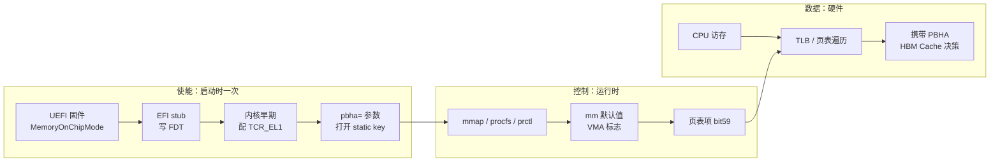
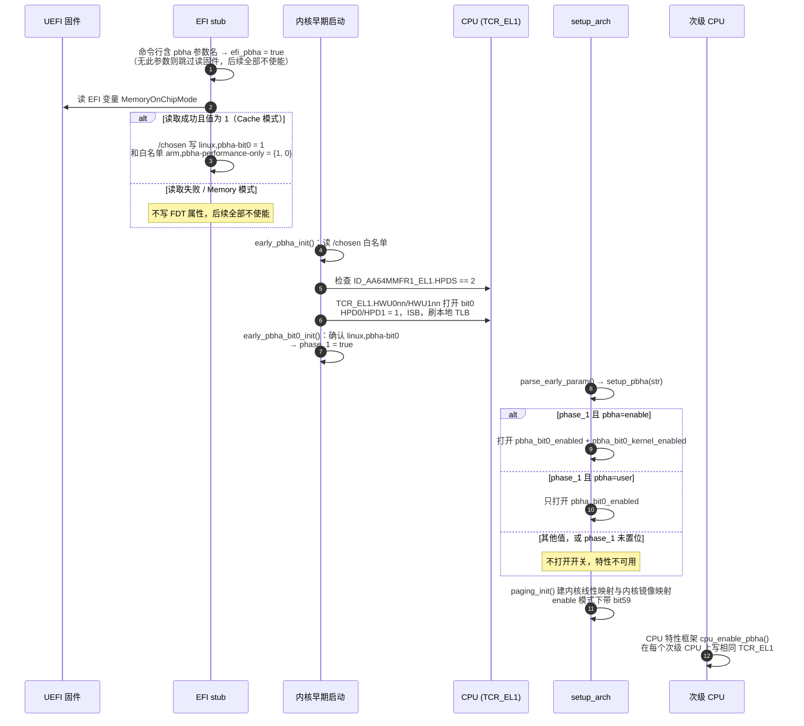
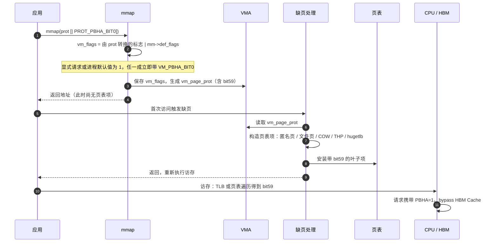
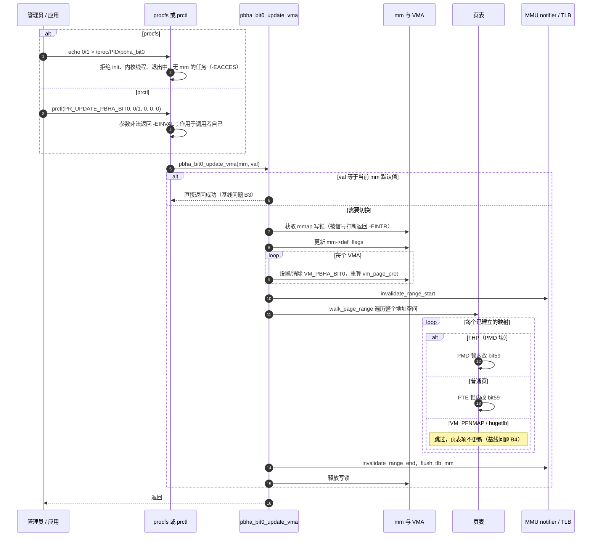
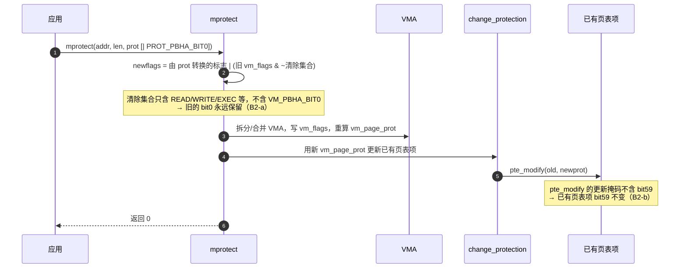
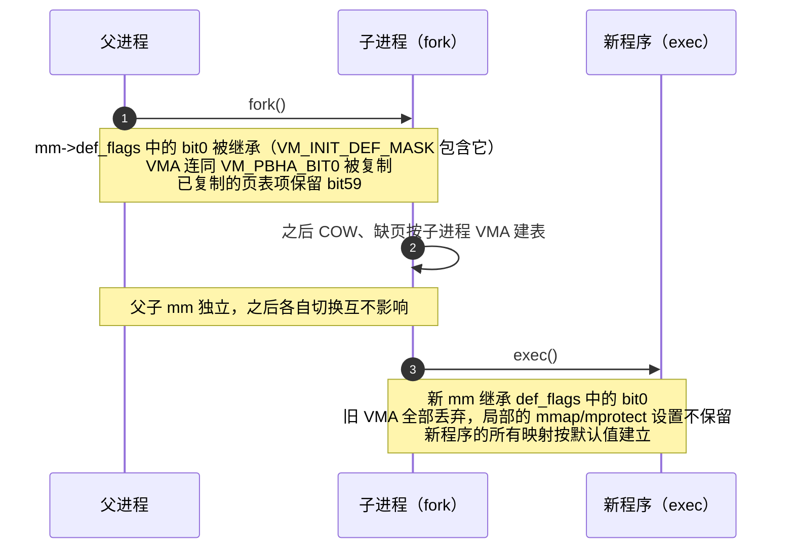

# PBHA bit0（HBM Cache Bypass）特性设计说明书

| 项目 | 内容 |
| --- | --- |
| 文档版本 | 2.0 |
| 更新日期 | 2026-10-23 |
| 适用范围 | openEuler OLK-5.10，Arm64，`CONFIG_ARM64_PBHA=y` |
| 代码基线 | `OLK-5.10` 分支，`042414da426d` |
| 读者 | 内核、固件、测试 |

本文只描述设计要点和关键流程。每个流程后列出“测试要点”，第 5 节汇总为测试矩阵。标注“基线问题”的条目是代码静态阅读结论，尚未在硬件上复现。

## 1. 特性概述

### 1.1 要解决的问题

平台的 HBM 工作在 Cache 模式（MoC，Memory on Chip Cache）时，所有访存默认都会进入 HBM Cache。流式、一次性访问的数据会把热点数据挤出 HBM Cache。本特性让软件按**进程**或按**地址范围**指定：这部分访存不进入 HBM Cache。

### 1.2 核心机制

Arm 的 PBHA（Page Based Hardware Attributes）允许页表叶子项的 bit[62:59] 携带实现自定义属性，CPU 访存时把它随请求送给后级硬件。本平台约定：

- **bit59（PBHA bit0）= 1**：该映射的访存 bypass MoC Cache，不分配 cache line。
- **bit59 = 0**：正常使用 MoC Cache。

由此推出三个设计前提：

1. PBHA 是**映射属性**，不是物理页属性。同一物理页可以经两个映射以不同 bit59 访问，数据一致性由硬件保证。
2. PBHA 只影响性能，不改变数据、权限和内存类型。
3. 设置 bit59 不会把平台切成 Memory 模式，也不绕过 CPU 的 L1/L2/L3。

### 1.3 范围

| 在范围内 | 不在范围内 |
| --- | --- |
| 启动时检测并使能 PBHA bit0 | 修改固件的 Cache/Memory 模式 |
| 用户态按进程（procfs/prctl）和按映射（mmap）控制 | 自动识别冷热数据、自动选择策略 |
| `pbha=enable` 下内核自身映射设置 bit0 | 虚拟机内使用 PBHA |
| 观测接口：smaps、pagemap、ptdump | 其他 PBHA 位（bit1~bit3）的平台语义 |

## 2. 总体设计

### 2.1 三个平面

- **使能**决定特性是否可用，只在启动时发生，运行时不能切换。
- **控制**把用户的策略写成软件状态，并最终落到页表项 bit59。
- **数据**完全由硬件完成，稳态访存不经过任何 PBHA 软件代码。

### 2.2 状态分层

PBHA 策略在四层保存。测试判定时必须分清看的是哪一层，它们不会自动一致。

| 层 | 载体 | 作用 | 观测方法 |
| --- | --- | --- | --- |
| 系统开关 | static key `pbha_bit0_enabled`、`pbha_bit0_kernel_enabled` | 特性是否可用；内核映射是否置位 | dmesg `pbha bit_0 enabled, kernel: N`；`/proc/<pid>/pbha_bit0` 文件是否存在 |
| 进程默认值 | `mm->def_flags` 中的 `VM_PBHA_BIT0` | 该进程**之后新建**的 VMA 默认带 bit0 | `cat /proc/<pid>/pbha_bit0` |
| 映射策略 | `vma->vm_flags` 中的 `VM_PBHA_BIT0`，及由它生成的 `vm_page_prot` | 该 VMA **之后缺页建立**的页表项带 bit59 | `/proc/<pid>/smaps` 的 VmFlags 含 `p0` |
| 硬件属性 | 页表叶子项 bit59 | 硬件实际使用的值 | `/proc/<pid>/pagemap` 记录的 bit59；内核映射看 ptdump 的 `PBHA0` |

核心规则：**上层状态只影响之后新建的下层状态**。改已有的下层状态需要显式操作，只有进程级接口（procfs/prctl）会同时改全部四层中的后三层。

### 2.3 接口一览

| 接口 | 用法 | 作用对象 |
| --- | --- | --- |
| 启动参数 | `pbha=user` 或 `pbha=enable` | 系统。`user` 只开放用户控制；`enable` 另外让内核映射和 init 进程的映射带 bit59 |
| procfs | `echo 0/1 > /proc/<pid>/pbha_bit0`（tgid 和 tid 目录下都有） | 目标进程整个 mm |
| prctl | `prctl(PR_UPDATE_PBHA_BIT0, 0/1, 0, 0, 0)`，`PR_UPDATE_PBHA_BIT0 = 0x82312f0` | 调用者自己的 mm |
| mmap | `prot` 中加 `PROT_PBHA_BIT0`（`0x1000`） | 新建的 VMA |
| mprotect | 同上 | 已有 VMA，基线行为有缺陷，见 3.4 |
| 内核驱动 | `pgprot_pbha(prot, val)` | 驱动自建的映射 |

`PROT_PBHA_BIT0`、`PR_UPDATE_PBHA_BIT0` 是 openEuler 私有 ABI，应用需使用该内核的头文件。

## 3. 关键流程

### 3.1 启动使能

使能要同时回答三个问题：平台是否处于 Cache 模式（固件），CPU 能否传递 PBHA（HPDS2），操作系统是否开放控制（启动参数）。三者任一不满足，特性就不可用，系统按原有行为运行。

设计要点：

- **为什么分两段**：TCR 配置必须在建立内核页表之前完成，所以放在 head.S 里 `early_fdt_map` 之后；static key 必须等 `jump_label_init()` 之后才能打开，所以模式解析放在 `setup_pbha()`。两者之间用 `phase_1` 标志衔接。
- **EFI stub 只认参数名，内核才解释值**：stub 看到 `pbha` 就去读固件；`user`/`enable` 由内核解析。
- **所有 CPU 必须一致**：启动 CPU 在早期配置，其余 CPU 由 CPU 特性框架在上线时配置，包括热插拔。

测试要点：

- 条件组合：固件 Cache/Memory 模式 × 参数 缺省/`user`/`enable`/非法值 × CPU 是否支持 HPDS2。只有“Cache + `user`/`enable` + HPDS2”组合使能。
- 使能判定：dmesg 有 `pbha bit_0 enabled, kernel: 0/1`；`/proc/self/pbha_bit0` 存在。不使能时该文件被隐藏。
- `enable` 模式：ptdump 中线性映射、vmalloc、fixmap 带 `PBHA0`；`user` 模式不带。
- 多核：每个 CPU（含热插拔上线的 CPU）的 TCR_EL1 HWU 位一致。
- **基线问题 B1**：命令行只写 `pbha` 不带值，在 Cache 模式下 `setup_pbha()` 收到 NULL 并直接 `strcmp`，预期早期启动空指针。必须作为异常用例覆盖。

### 3.2 新建映射：mmap 与缺页

策略分两步落地：`mmap` 只把策略记在 VMA 上，不建页表；首次访问缺页时，用 VMA 的属性模板 `vm_page_prot` 构造页表项，bit59 随之写入。

设计要点：

- **默认值不可被 mmap 覆盖**：`mmap` 把显式请求和 `mm->def_flags` 做或运算。进程默认值为 1 时，`mmap` 不带 `PROT_PBHA_BIT0` 仍然得到 bit0，无法在 mmap 时关闭。
- **所有建表路径共用 `vm_page_prot`**：bit59 由 `vm_page_prot` 带入，因此匿名页、零页、文件页、THP、hugetlb 的新建映射都覆盖。PTE 级路径（匿名页、COW、文件页）和 hugetlb 另外调用 `maybe_mk_pbha_bit0()` 再次确认。
- **特性未使能时 `PROT_PBHA_BIT0` 被拒绝**：`mprotect` 返回 `-EINVAL`；`mmap` 不报错，但 VMA 不带该标志。

测试要点：

- `mmap` 带/不带 `PROT_PBHA_BIT0` × 进程默认值 0/1，检查 smaps `p0` 和访问后 pagemap bit59。预期：任一为 1 即置位。
- 覆盖映射类型：匿名私有、匿名共享、文件映射、THP（`madvise(MADV_HUGEPAGE)`）、hugetlb、COW（fork 后写）。
- 只 mmap 不访问：smaps 有 `p0`，pagemap 无有效页。

### 3.3 进程级切换：procfs / prctl

进程级接口把整个 mm 切到新策略。只改默认值不够：已有 VMA 和已经建好的页表项都不会自己变。所以更新分三步：改默认值、改所有 VMA、遍历页表改已有叶子项，最后刷 TLB。

设计要点：

- **作用于 mm，不是线程**：同一进程的线程共享 mm，写任意一个 tid 的文件都影响整个进程。
- **未访问的页不预先分配**：只改 VMA，之后缺页按 3.2 建表。
- **成功返回后生效**：TLB 已刷新，返回后的访存使用新属性；切换过程中正在进行的访存不保证原子切换，PBHA 只影响性能，这一点可以接受。
- **代价**：遍历整个地址空间并刷全 mm TLB，不适合高频调用。

测试要点：

- 0→1、1→0 两个方向，分别验证 `/proc/<pid>/pbha_bit0`、smaps `p0`、已访问页的 pagemap bit59、未访问页访问后的 bit59。
- 覆盖普通页、THP、hugetlb、`VM_PFNMAP`（如 `/dev/mem` 映射）。预期普通页和 THP 已有映射被更新；hugetlb、PFNMAP 已有映射不更新（B4）。
- 多线程进程：从一个 tid 写，其他线程的映射同样变化。
- 权限：写 init（pid 1）、内核线程返回 `-EACCES`；非特权用户写他人进程被文件权限拒绝；目标进程正在退出。
- 并发：切换与并行缺页、`munmap`、进程退出、信号打断同时进行，无死锁、无 oops。
- **基线问题 B3**：默认值为 0 时，用 `mmap(PROT_PBHA_BIT0)` 建的 VMA，再 `echo 0` 不会清除它（提前返回）。只有先 `echo 1` 再 `echo 0` 才能清干净。

### 3.4 mprotect：修改已有范围

`mprotect` 的设计意图是像读写权限一样重新指定 PBHA：传入 `PROT_PBHA_BIT0` 则设置，不传则清除，只影响指定范围，不改进程默认值。基线实现与此不一致，问题出在两处。

| 场景 | 设计意图 | 基线实际结果 |
| --- | --- | --- |
| 对无 bit0 的范围传入 `PROT_PBHA_BIT0` | VMA 和已有页表项都置位 | VMA 置位；已有页表项不变，只有之后新缺页的页置位 |
| 对有 bit0 的范围不传 `PROT_PBHA_BIT0` | VMA 和已有页表项都清除 | 都不清除 |
| 任意情况 | 不改 `mm->def_flags` | 符合 |

修复方向：把 `VM_PBHA_BIT0` 加入 mprotect 的旧标志清除集合，并把 `PTE_PBHA0` 加入 `pte_modify()` 的更新掩码（普通页、THP、hugetlb 的修改路径都经过它）。注意修复后行为变化：应用只想改读写权限时，必须继续传 `PROT_PBHA_BIT0` 才能保留 bit0。

测试要点：上表三行各一个用例，分别检查 smaps `p0` 和 pagemap bit59；修复前预期失败的用例需标为已知问题，不能判为通过。

### 3.5 继承：fork 与 exec

设计要点：

- **默认值沿进程树向下传递**：对一个 shell 或启动器写 1，它之后 fork + exec 出的所有程序都默认带 bit0。这是预期的主要使用方式。
- **局部设置不跨 exec**：只在某个 VMA 上设置的 bit0，exec 后消失。
- **init 的特例**：`pbha=enable` 下，init 进程每次缺页都会给对应 VMA 打上 bit0，但不改 init 的 `def_flags`，所以 init 之后 exec 出的进程不会因此默认带 bit0。procfs 不允许修改 init。

测试要点：

- 父进程默认值 1 → fork 子进程：子进程 `pbha_bit0` 为 1，已有页 bit59 保留，COW 后的新页带 bit59。
- 父进程默认值 1 → fork + exec：新程序 `pbha_bit0` 为 1，新程序映射全部带 bit0。
- 父进程默认值 0，仅一个 VMA 带 bit0 → exec 后无 `p0`。
- fork 后修改父进程，子进程不受影响；反之亦然。
- 两个进程以不同 bit59 映射同一共享内存（`MAP_SHARED` 文件或 shm），并发读写，数据一致。

### 3.6 观测接口

| 接口 | 反映的层 | 注意事项 |
| --- | --- | --- |
| `/proc/<pid>/pbha_bit0` 读 | 进程默认值 | 不代表所有 VMA 或页表项的状态 |
| smaps VmFlags `p0` | VMA 标志 | `p0` 表示“bit0 已设置”，不是“值为 0” |
| pagemap bit59 | 页表项 bit59 | 普通页、THP 支持；**hugetlb 映射不导出，恒为 0（B5）**，不能据此判定 hugetlb 页未置位 |
| ptdump `PBHA0` | 内核页表 | 需开启 `CONFIG_PTDUMP_DEBUGFS` |

软件观测只能证明页表属性已设置。HBM Cache 是否真的被 bypass，需要用平台 PMU 计数器或带宽/延迟测试确认。

## 4. 虚拟化

PBHA 在 Stage 1 和 Stage 2 之间如何合成由 CPU 实现决定。内核只对已知 Stage 2 覆盖 Stage 1 的 Arm 核心（Neoverse N1、Cortex-A76/A77/A78）开放 Guest 使用，其他 CPU 上 KVM 将 Stage 2 的 PBHA 设为 0，Guest 无法影响 Host。此外，EFI 早期使能路径不计算 Guest 可用位，因此本特性**不支持虚拟机内使用 PBHA**。测试只需确认：Host 使能后，Guest 正常运行，且 Guest 内无法通过页表影响 Host 的 HBM Cache 行为。

## 5. 测试矩阵

| 编号 | 类别 | 用例 | 预期结果 |
| --- | --- | --- | --- |
| T1 | 使能 | 固件 Cache/Memory × 参数缺省/`user`/`enable`/`pbha=xyz` | 仅 Cache + `user`/`enable` 使能；其余正常启动，`/proc/*/pbha_bit0` 不存在 |
| T2 | 使能 | Cache 模式 + 裸参数 `pbha` | 设计要求不崩溃、不使能；**基线预期 oops（B1）** |
| T3 | 使能 | 关闭 `CONFIG_ARM64_PBHA` 编译 | 编译通过，所有接口不存在 |
| T4 | 使能 | 多核与 CPU 热插拔 | 每个 CPU TCR_EL1 HWU 位一致 |
| T5 | 内核映射 | `enable` vs `user` 下 ptdump | `enable` 下线性映射、vmalloc、fixmap 带 PBHA0；`user` 下不带 |
| T6 | mmap | 显式标志 × 默认值，多种映射类型 | 任一为 1 即 `p0` 且访问后 bit59=1 |
| T7 | 进程级 | procfs/prctl 0→1、1→0 | 默认值、VMA、普通页/THP 已有页表项一致变化 |
| T8 | 进程级 | hugetlb、VM_PFNMAP 已有映射 | 已有项不更新（B4）；hugetlb 新缺页按新策略 |
| T9 | 进程级 | 默认 0 + mmap 显式 bit0，再写 0 | **基线不清除（B3）** |
| T10 | 进程级 | 非法值、init、内核线程、退出中、权限不足、信号打断 | 分别返回 `-EINVAL`/`-EACCES`/`-EACCES`/`-EACCES`/`-EACCES`/`-EINTR`，无副作用 |
| T11 | 并发 | 多线程切换 + 并行缺页 + munmap + 退出 | 无死锁、无 oops，结束后状态一致 |
| T12 | mprotect | 3.4 表中三种场景 | **基线已有页表项不变、无法清除（B2）** |
| T13 | 继承 | fork、fork+exec、局部设置后 exec | 符合 3.5 |
| T14 | 正确性 | 不同 bit59 映射同一物理页并发读写 | 数据一致 |
| T15 | 观测 | pagemap 读 hugetlb 页 | **基线恒为 0（B5）** |
| T16 | 虚拟化 | Host 使能后运行 Guest | Guest 正常，Host 不受 Guest 影响 |
| T17 | 性能 | 关闭态开销；切换耗时与地址空间大小的关系；目标负载 HBM 命中率/带宽 | 关闭态无可测开销；切换耗时随 VMA 数和已映射页数线性增长；bypass 后 HBM Cache 命中行为按平台预期变化 |

## 6. 基线问题与待确认项

| 编号 | 问题 | 影响 | 关联用例 |
| --- | --- | --- | --- |
| B1 | `setup_pbha()` 未判空，裸参数 `pbha` 导致空指针 | Cache 模式下启动崩溃 | T2 |
| B2 | mprotect 不清除旧 `VM_PBHA_BIT0`；`pte_modify()` 掩码不含 bit59 | mprotect 无法清除 bit0，也不更新已有页表项 | T12 |
| B3 | `pbha_bit0_update_vma()` 只比较默认值就提前返回，且比较在写锁之外 | 局部设置无法通过写同值清理；并发写有竞态 | T9、T11 |
| B4 | 进程级遍历跳过 `VM_PFNMAP`，且没有 hugetlb 回调；`walk_page_range()` 返回值被忽略 | 这两类 VMA 标志已改但已有页表项未改，且返回成功 | T8 |
| B5 | `pagemap_hugetlb_range()` 未导出 bit59 | hugetlb 映射观测失真 | T15 |
| B6 | `early_pbha_init()` 读 `/cpus` 回退时写成 `if (prop) return` | 仅影响通过 `/cpus` 描述 PBHA 的设备树平台，本 EFI 平台不受影响 | — |
| Q1 | THP 更新直接覆写有效 PMD，未做 break-before-make | 需芯片确认仅改 PBHA 位是否允许不做 BBM | T7 |
| Q2 | bit59 的 bypass 语义、别名一致性、切换时是否需要额外 cache 维护 | 需芯片规格确认 | T14、T17 |

## 7. 代码落点

路径相对 OLK-5.10 内核源码根目录。

| 模块 | 文件 |
| --- | --- |
| EFI stub：参数识别、读固件、写 FDT | `drivers/firmware/efi/libstub/efi-stub-helper.c`、`drivers/firmware/efi/libstub/fdt.c` |
| 早期使能、TCR 配置、CPU 特性、KVM 能力 | `arch/arm64/kernel/head.S`、`arch/arm64/kernel/cpufeature.c` |
| bit0 核心：启动参数、进程级更新 | `drivers/soc/hisilicon/pbha.c`、`include/linux/pbha.h` |
| 用户标志转换、页表位定义 | `arch/arm64/include/asm/mman.h`、`arch/arm64/include/asm/pgtable.h`、`arch/arm64/include/asm/pgtable-hwdef.h` |
| 用户接口 | `fs/proc/base.c`、`kernel/sys.c`、`arch/arm64/include/uapi/asm/mman.h`、`include/uapi/linux/prctl.h` |
| 建表路径 | `mm/memory.c`、`arch/arm64/mm/hugetlbpage.c`、`arch/arm64/mm/mmu.c`、`mm/vmalloc.c` |
| 继承 | `include/linux/mm.h`（`VM_INIT_DEF_MASK`）、`kernel/fork.c` |
| 观测 | `fs/proc/task_mmu.c`、`arch/arm64/mm/ptdump.c` |
| KVM Stage 2 | `arch/arm64/kvm/reset.c` |

参考：[openEuler PR !2481](https://gitee.com/openeuler/kernel/pulls/2481)（2023-10 合入 OLK-5.10）；[openEuler PBHA v2 补丁系列](https://mailweb.openeuler.org/archives/list/kernel@openeuler.org/thread/TIJIJA5JUR6D7CMNE7Q46MCNS4VJPCZ4/)；需求 [issue #9826](https://atomgit.com/openeuler/kernel/issues/9826)。
