# PBHA / HBM Cache 精细控制特性设计说明书

| 项目 | 内容 |
| --- | --- |
| 文档版本 | 1.2，设计评审稿 |
| 更新日期 | 2026-10-23；统一时序图，按使能、控制、继承与观测重排设计章节 |
| 编写日期 | 2026-10-22 |
| 适用对象 | 内核、固件、芯片平台、虚拟化及测试开发人员 |
| 适用范围 | openEuler OLK-5.10，Arm64，基于 HPDS2 的 PBHA 支持及平台 PBHA bit0 控制 |
| 代码基线 | `olk-5.10`，提交 `3259571c06a2e93b139c56075c6a5b8e7a5fdc69` |
| 文档定位 | 描述特性目标、模块职责、接口契约、关键流程和验收条件；函数作为设计落点，不按补丁顺序展开 |

本文中的“设计要求”表示应满足的契约，“基线行为”表示由上述代码确认的行为。尚未满足或未经验证的事项集中记录在第 10 节。本文未包含硬件实测结果。

## 1. 背景与目标

HBM 等片上或近片高速存储在 Cache 模式下，其容量、带宽和分配行为会影响不同负载之间的缓存竞争。操作系统需要按映射表达缓存使用策略，使应用能够为不同工作集选择平台支持的访问行为。

Arm HPDS2 提供页表硬件属性机制：在所用描述符格式下，允许将叶子页表项的 `[62:59]` 位用于实现定义的硬件用途。这四个位承载 Page Based Hardware Attributes，简称 PBHA。CPU 经相应映射访存时，向后续硬件传递有效 PBHA 属性。

本特性在通用 PBHA 支持上，使用 PBHA bit0，即叶子页表项 bit59，提供 HBM Cache 使用策略的控制能力。

### 1.1 设计目标

1. 在 CPU、固件描述及平台模式满足条件时启用 PBHA，限制使用固件声明为仅影响性能的属性值。
2. 提供启动级、进程地址空间级和单映射级策略入口。
3. 将策略落实到已有映射和后续新建映射，处理页表更新与 TLB 一致性。
4. 使稳态访存由硬件执行属性处理，不增加逐次访存的软件回调。
5. 提供策略状态与页表属性观测能力，并明确虚拟化和特殊映射的支持边界。

### 1.2 范围与边界

| 范围 | 设计内容 |
| --- | --- |
| 通用 PBHA | CPU 能力检测、固件值白名单、Stage 1 属性开放、驱动映射属性辅助接口 |
| 平台 bit0 | 识别 MemoryOnChip Cache 模式，提供用户映射和内核映射策略 |
| 用户地址空间 | `mmap` 属性、进程级 `procfs/prctl` 控制、后续缺页映射的属性生成 |
| 内核地址空间 | 在已接入的建表路径中按启动策略设置 bit0 |
| KVM | 按已知的 Stage 1/Stage 2 合成规则约束 Guest 可使用的属性 |
| 不在本设计范围 | 自动识别冷热数据、自动选择最优策略、改变固件 Cache/Memory 模式、迁移物理页到 HBM、管理 HBM 容量配额 |

PBHA 是**映射属性**。同一物理页可以有多个虚拟映射，因此不应把 PBHA 理解为 `struct page` 上唯一的全局属性。

按本文采用的平台语义及相关讨论 [issue #9826](https://atomgit.com/openeuler/kernel/issues/9826)，PBHA bit0（页表 bit59）置 `1` 表示 Bypass MoC Cache，不把 cache line 加入 MoC；置 `0` 表示不请求该 bypass，允许使用正常的 MoC Cache 策略。该含义属于本平台约定，不是 Arm 为所有 PBHA 实现规定的统一语义。

必须区分两个层次：`MemoryOnChipMode=1` 表示平台整体处于 Cache 模式；`PBHA0=1` 表示某个映射的访问请求 bypass。在平台保持 Cache 模式的前提下，可以按进程或 VMA 决定哪些访问使用缓存、哪些访问绕过。设置 PBHA0 不会把 HBM/MoC 切换成 Memory 模式，也不表示绕过 CPU 的所有缓存层级。具体命中处理、适用区域及维护要求仍需结合芯片规格验证。issue #9826 的内容据讨论为 AI 辅助整理，可能来自代码分析，不能作为接口设计预期的独立证据，尤其不能据此认定 mprotect 只应影响后续建表。

## 2. 术语与运行前提

| 术语 | 含义 |
| --- | --- |
| HPDS | Hierarchical Permission Disables，支持关闭上级页表的层级权限限制 |
| HPDS2 | 扩展上述能力，允许指定叶子描述符位用于硬件自定义属性 |
| 叶子页表项 | 直接映射物理内存、使本次页表遍历结束的条目；可以是 Page，也可以是 Block |
| PBHA bit0 | PBHA 值的最低位，对应本基线描述符的 bit59 |
| performance-only | 固件声明该 PBHA 值仅影响性能，不改变数据内容、解释或正确性 |
| Feature 使能 | 建立硬件可用性、允许属性集合和系统级策略开关 |
| 控制面 | 接受策略请求、管理软件状态、更新页表并完成必要同步 |
| 数据面 | CPU 在访存时消费页表/TLB 属性，平台硬件执行对应行为 |

运行前提如下：

- CPU 支持本方案使用的 HPDS2 和页表描述符格式，各 CPU 对所启用属性的含义一致。
- 固件提供可信的平台模式及 PBHA performance-only 描述。
- 使用 bit0 的平台处于 `MemoryOnChipMode == MOC_MODE_CACHE`，且 PBHA 值 `1` 在允许集合中。
- PBHA 不改变访问权限、内存类型或数据语义；共享页、内核别名及默认属性访问保持数据正确。
- 属性变化满足平台关于页表更新、TLB 失效和必要缓存维护的要求。

在常见的 Arm64 4KB 页粒度、48 位虚拟地址配置中，4KB 映射叶子位于 PTE，2MB Block 位于 PMD，1GB Block 位于 PUD。该格式能力不代表本特性的所有运行时更新接口均已覆盖这些映射类型。

## 3. 总体设计

### 3.1 架构与职责

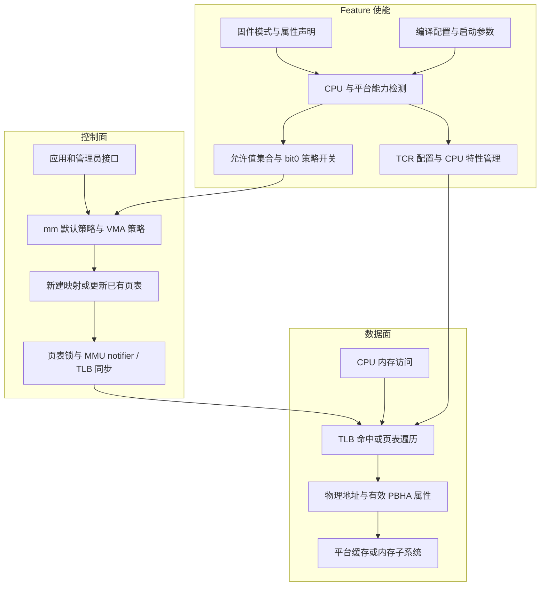

页表构造和页表修改是控制面向数据面提交策略的边界。缺页发生后，内核按已保存策略生成映射；映射建立后的普通访问由硬件处理。

### 3.2 状态模型

| 状态 | 载体 | 生命周期与作用 |
| --- | --- | --- |
| 属性值白名单 | `arm64_pbha_perf_only_values` | 启动阶段生成；以 PBHA 值为索引的位图 |
| Stage 1 开放位 | `pbha_stage1_enable_bits` | 启动阶段生成；写入 HWU 的四位掩码 |
| 通用探测状态 | `pbha_enabled` | 基线中的一次性探测/初始化标记；不能单独作为硬件已有效使能的证据 |
| 平台 bit0 就绪 | `pbha_enabled_phase_1` | 标识早期平台检查通过，允许后续解析 bit0 模式 |
| bit0 功能开关 | `pbha_bit0_enabled` | 启动时设置的 static key，决定 bit0 控制路径是否可用 |
| 内核 bit0 开关 | `pbha_bit0_kernel_enabled` | 启动时设置的 static key，决定已接入内核映射路径是否附加 bit0 |
| 地址空间默认策略 | `mm->def_flags & VM_PBHA_BIT0` | 控制该 mm 后续映射的默认属性，也是 procfs 返回的状态 |
| 单映射策略 | `vma->vm_flags & VM_PBHA_BIT0` | 表达具体 VMA 的 bit0 策略 |
| 建表属性模板 | `vma->vm_page_prot` | 把 VMA 策略转换为可用于新建页表项的属性 |
| 已提交硬件属性 | 叶子项 bit59 和有效 TLB 属性 | 实际访存所消费的状态 |

以上状态不得相互替代：编译支持不代表启动启用，启动启用不代表每个映射都设置 bit0，进程默认值也不代表其所有 VMA 和现存页表项完全一致。

## 4. Feature 使能设计

### 4.1 配置与模式

编译开关为 `CONFIG_ARM64_PBHA`。Kconfig 默认值为 `n`，本基线的 `openeuler_defconfig` 显式设置为 `y`；功能编入内核后仍需通过平台和启动条件检查。

| 启动模式 | bit0 控制能力 | 内核映射策略 | 用户映射策略 |
| --- | --- | --- | --- |
| 未指定 `pbha` | 在本 EFI bit0 路径下不启用 | 保持原有行为 | 不开放平台 bit0 控制路径 |
| `pbha=user` | 条件满足后启用 | 不通过该平台辅助函数自动设置 bit0 | 由进程级或映射级策略选择 |
| `pbha=enable` | 条件满足后启用 | 已接入路径设置 bit0 | 保留控制接口，并包含 global init 的特殊缺页处理 |

模式选择发生在启动期间；设计不提供运行时切换全局模式的 sysctl 或模块参数。运行时调整对象是用户地址空间策略。

仅提供通用 PBHA 的设备树平台可能有不同入口，不应由“未指定 pbha”推导出所有 PBHA 硬件能力都被关闭。

### 4.2 固件描述契约

EFI stub 读取 `MemoryOnChipMode`，确认平台已经处于 Cache 模式后，把平台信息传给内核。它不负责改变固件模式。

| 输入或输出 | 格式与含义 |
| --- | --- |
| EFI 变量 `MemoryOnChipMode` | 本基线按 `u8` 读取；`0` 表示 Memory 模式，`1` 表示 Cache 模式 |
| EFI 变量 GUID | `21f3b3c5-946d-41c1-838c-194e48aa41e2` |
| `/chosen/linux,pbha-bit0` | 本基线写入单字节值 `1`，供平台 bit0 检测使用 |
| `arm,pbha-performance-only` | 字节形式的 PBHA 值列表，每个有效值范围为 `0..15`；不能当作一个整数位掩码解析 |

EFI 路径将上述属性写入 `/chosen`；通用设计兼容 `/cpus` 的 performance-only 描述。选择规则为优先使用 `/chosen`，再考虑 `/cpus`；基线回退路径的实现问题见第 10 节。

本基线 EFI 代码使用 `u8 arr[16] = { 0x1 }`，写出的列表包含 `1` 和十五个 `0`。其有效信息是默认值 `0` 与 bit0 值 `1`，不代表开放所有十六种属性值。

### 4.3 启动流程

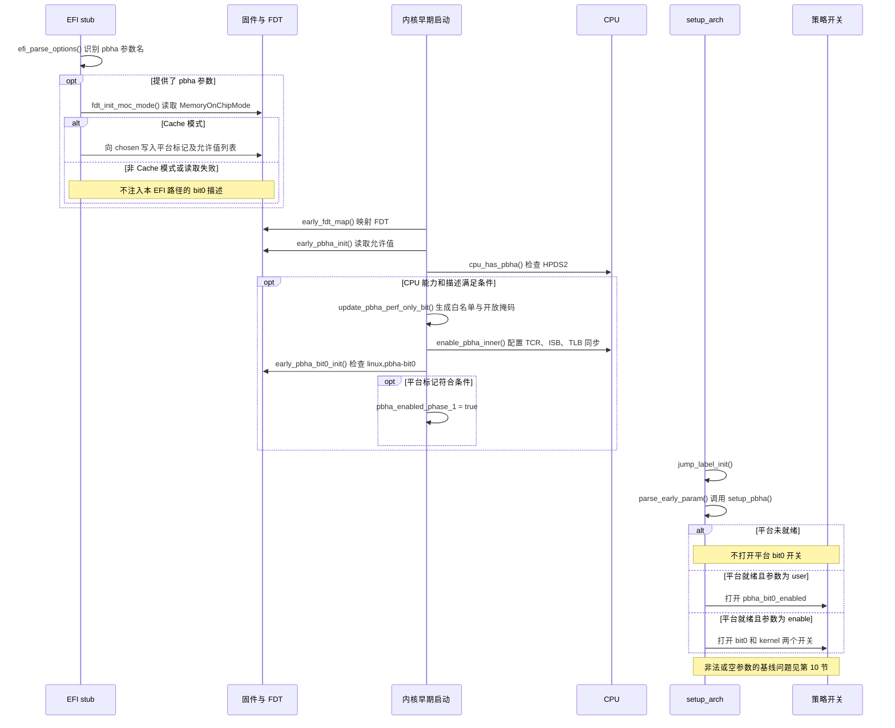

采用分阶段初始化的原因：CPU 属性能力需要在早期内存映射构建前准备；平台策略开关采用 static key，应在 jump label 初始化完成后启用。EFI stub 与内核分别解释同一参数的不同部分：前者识别参数名，后者解释 `user/enable` 模式。

#### 分阶段初始化的职责

使能过程分别解决三个问题：固件是否提供了适用的平台模式、CPU 是否能够传递这些属性、操作系统是否开放对应控制接口。三者成立后，应用才能选择具体映射的 PBHA 属性；使能本身不等于给所有用户页设置 bit59。

图中描述正常设计流程；FDT 写入失败由 EFI 启动流程处理，属性回退和异常参数的基线差距见第 10 节。

- **EFI stub 负责传递平台信息**：`/chosen` 是 FDT 中保存启动配置的节点。`linux,pbha-bit0=1` 表示固件报告了适用的 Cache 模式，不是给某个页表项写入 `1`。
- **通用初始化负责开放硬件属性位**：`arm,pbha-performance-only` 是允许值列表。例如 `{1, 0, ...}` 表示允许值 `0` 和 `1`；软件保存允许值集合，硬件配置只开放这些值涉及的位。
- **平台初始化负责开放软件策略**：`pbha_enabled_phase_1` 只是早期阶段完成标记。`setup_pbha()` 在 static key 可以使用之后，再决定开放用户控制，还是同时对已接入的内核建表路径设置 bit0。
- **CPU 特性框架负责其他 CPU 的一致配置**：后续通过 `cpu_enable_pbha()` 接续早期设置。不能只配置启动 CPU，否则任务迁移后可能遇到不同的属性解释。

### 4.4 函数职责

| 函数 | 输入与职责 | 输出或状态变化 |
| --- | --- | --- |
| `efi_pe_entry()` | EFI 启动入口，组织命令行解析和 FDT 交付 | 将准备好的 FDT 交给内核 |
| `efi_parse_options()` | 识别 `pbha` 参数名 | `efi_pbha = true`，不解释模式值 |
| `fdt_init_moc_mode()` | 校验 EFI 请求及固件 Cache 模式 | 写入平台与允许值属性 |
| `early_fdt_map()` | 将 FDT 物理地址映射到早期地址空间 | 保存 `early_fdt_ptr` |
| `early_pbha_init()` | 组织 FDT 读取、CPU 检测、寄存器配置及 bit0 检测 | 建立通用 PBHA 早期状态 |
| `cpu_has_pbha()` | 读取 `ID_AA64MMFR1_EL1.HPDS` | 基线早期路径要求字段值等于 `2` |
| `update_pbha_perf_only_bit()` | 解析合法属性值 | 同时更新允许值位图与硬件开放位掩码 |
| `enable_pbha_inner()` | 按开放位配置当前 CPU | 写 TCR，执行 ISB 和本地 TLB 刷新 |
| `early_pbha_bit0_init()` | 检查通用状态及 `/chosen/linux,pbha-bit0` | `pbha_enabled_phase_1 = true` |
| `setup_pbha()` | 在平台就绪后解析模式值 | 打开 bit0 及可选的内核 bit0 static key |
| `plat_can_use_pbha_stage1()` | 接入 CPU 特性框架，检查 CPU 与系统平台条件 | 确定 Stage 1 能力是否成立 |
| `cpu_enable_pbha()` | CPU 特性框架的使能回调 | 调用 `enable_pbha_inner()` 配置对应 CPU |

### 4.5 硬件使能与多 CPU 一致性

`enable_pbha_inner()` 使用 `pbha_stage1_enable_bits` 配置 `TCR_EL1.HWU0nn/HWU1nn`，并设置 `HPD0/HPD1`。前者开放指定 PBHA 位，后者关闭相应地址空间的层级权限；叶子项自身的访问权限仍然有效。

寄存器写入后执行 `isb()` 和 `local_flush_tlb_all()`。启动 CPU 的早期设置由后续 CPU 特性框架接续：`setup_system_capabilities()` 完成系统能力检测，并通过 `.cpu_enable` 回调在相关 CPU 上安装配置。CPU 热插拔应遵守该框架的能力兼容检查。

例如允许值为 `5` 时，硬件开放掩码设置 bit0、bit2，而值白名单置位索引 `5`。两者用途不同，硬件开放位不能代替软件值校验。

### 4.6 不满足条件时的行为

- 未编译支持、CPU 不支持或平台不处于 Cache 模式时，不启用平台 bit0 策略。
- 读取 EFI 变量失败时，EFI 辅助函数不注入该平台属性，继续原启动流程；写 FDT 属性失败则向调用者返回错误，由 EFI 启动流程处理。
- 缺失或非法固件属性不应导致访问空指针或误开放属性，解析路径必须有边界检查。
- 启动参数应明确使用 `pbha=user` 或 `pbha=enable`。空值和非法值的健壮性属于验收条件，不能把裸 `pbha` 作为已验证用法。

## 5. 控制面设计

### 5.1 策略粒度与接口

运行时用户控制分为两类：**进程级的 procfs、prctl**，以及**地址范围级的 mmap、mprotect**。此外，启动参数负责功能使能和内核映射策略，内核辅助函数供驱动构造映射属性。

进程级接口操作的是 `mm_struct`。多个线程共享同一 mm 时，修改影响整个共享地址空间，不是某个线程的私有策略。地址范围级接口只影响当前地址空间中的指定范围，不修改进程默认值。

| 类别 | 入口及调用方式 | 控制对象 | 设计行为 |
| --- | --- | --- | --- |
| 进程级：外部指定目标 | 向 `/proc/<pid>/pbha_bit0` 写入 `0` 或 `1` | 指定任务的 mm，受访问权限及任务检查约束 | 更新默认策略、已有 VMA 和受支持的已有页表 |
| 进程级：应用自控制 | `prctl(PR_UPDATE_PBHA_BIT0, val, 0, 0, 0)` | 调用者当前 mm | 与 procfs 汇聚到同一个更新函数，`val` 为 `0/1` |
| 地址范围级：新建 | `mmap(..., prot \| PROT_PBHA_BIT0, ...)` | 新建 VMA | 显式设置属性，并合入 mm 默认标志；后续建表使用该策略 |
| 地址范围级：修改 | `mprotect(addr, len, prot)` | 当前 mm 的指定已有地址范围 | 按本次 `prot` 设置或清除 PBHA，并同步已有映射；这是第 5.4 节的目标语义，基线尚有缺口 |
| 系统启动级 | `pbha=user` / `pbha=enable` | 功能开关和内核映射策略 | 前者开放用户控制，后者同时对已接入内核建表路径启用 bit0 策略；不等于所有用户页自动置位 |
| 内核映射辅助接口 | `pgprot_pbha(prot, value)` | 驱动等内核代码构造的映射属性 | 生成允许值范围内的 PBHA 属性，调用者负责把它用于具体建表；不是用户态系统调用 |

本基线 ABI 常量为 `PROT_PBHA_BIT0 = 0x1000`、`PR_UPDATE_PBHA_BIT0 = 0x82312f0`。这些是该 openEuler 分支的扩展，不能直接当作其他内核的通用 ABI。编译应用时应使用匹配的目标头文件。

### 5.2 进程级控制：入口与三层状态更新

#### 5.2.1 procfs 与 prctl 入口

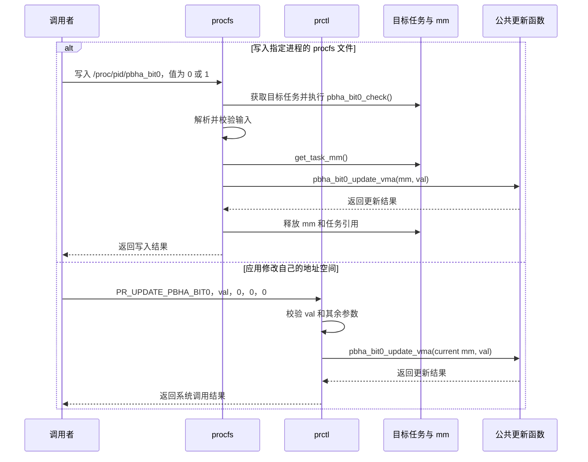

提供两种入口是为了覆盖不同使用方式：procfs 便于管理员或管理程序指定目标进程，prctl 便于应用主动调整自身策略。公共函数统一执行状态和页表更新；入口层的目标检查并不完全相同，不能把 procfs 的所有限制推定为 prctl 的行为。

读取 `/proc/<pid>/pbha_bit0` 返回的是 mm 默认策略；`smaps`、`pagemap` 和 ptdump 是观测接口，不是额外的策略修改入口，详见第 5.8 节。

#### 5.2.2 公共更新流程

进程级请求表达的是“该地址空间采用指定策略”。只改其中一层，会使新旧映射采用不同属性。因此更新由默认策略、现有 VMA 和现有页表三部分组成。

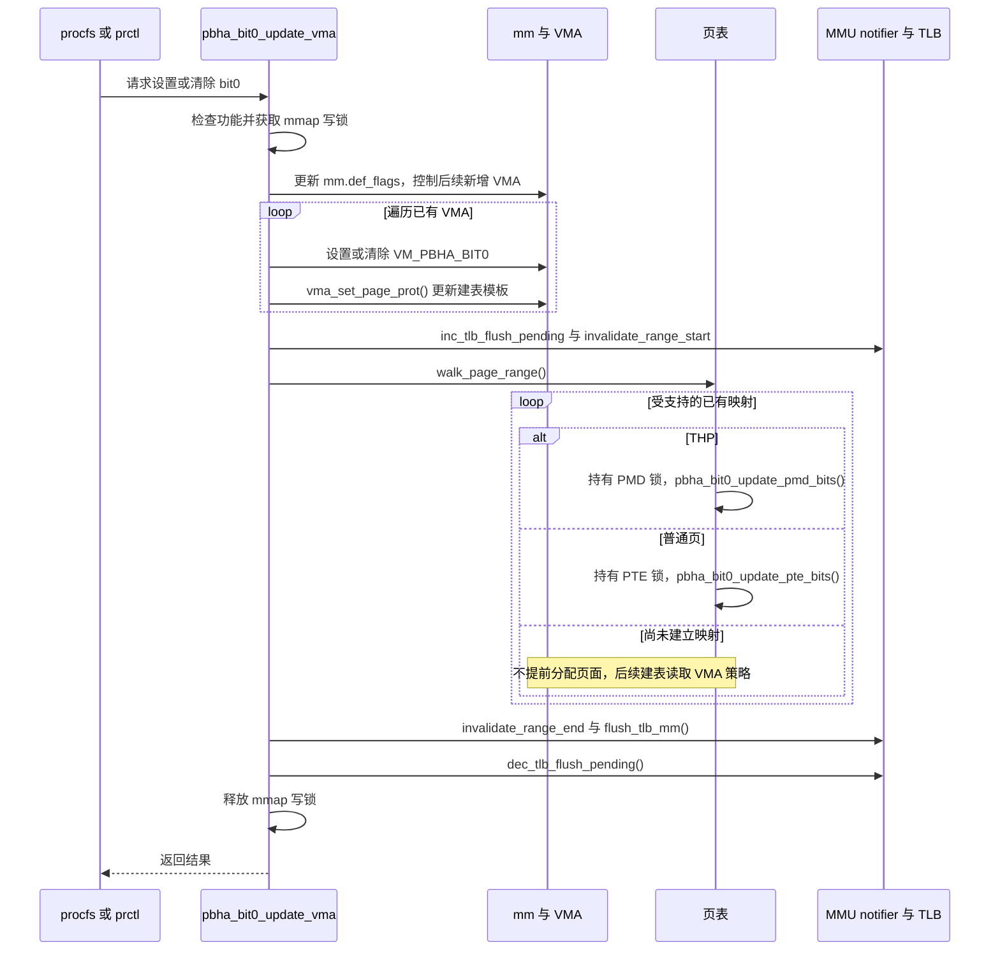

| 更新对象 | 生效对象 | 为什么需要 |
| --- | --- | --- |
| `mm->def_flags` | 后续新增 VMA | 新的 `mmap` 可以继承进程默认策略 |
| `vm_flags` 与 `vm_page_prot` | 已有 VMA 中后续建立的映射 | 尚未访问的页面，以及需要重新建表的路径，有可读取的持久策略 |
| 已有 leaf entry 与 TLB | 已经建立映射的页面 | 现有访问不一定再次缺页，必须主动更新属性并使旧转换失效 |

图中为受支持映射的更新设计，未把所有特殊映射归入普通页。基线 walker 跳过 `VM_PFNMAP`，也没有 hugetlb 专用回调；其边界见第 5.6 节。基线按 mm 默认值提前返回的行为不代表所有 VMA 已经一致，设计上不能只凭默认值判断整个地址空间无需修改。

关键职责如下：

| 函数 | 设计职责 |
| --- | --- |
| `pbha_bit0_check()` | procfs 目标任务检查；拒绝 global init、无 mm、内核线程、退出中任务等目标 |
| `pbha_bit0_write()` | 解析 `0/1`，获取任务与 mm 引用，提交更新 |
| `pbha_bit0_update_vma()` | 管理 mm/VMA 策略、组织遍历和失效通知 |
| `pbha_bit0_test_walk()` | 排除不纳入普通页表遍历处理的 `VM_PFNMAP` 映射 |
| `pbha_bit0_pte_range()` | 区分 THP PMD 与普通 PTE，取得对应页表锁 |
| `pbha_bit0_update_pte_bits()` | 对 present PTE 使用保护属性修改接口设置或清除 bit0 |
| `pbha_bit0_update_pmd_bits()` | 更新已识别的 THP PMD 属性 |

### 5.3 mmap：创建范围并保存策略

新映射的策略由显式请求和 mm 默认标志合成。`do_mmap()` 合入 `mm->def_flags`，因此默认值为 `1` 时，仅在 `mmap` 参数中省略 `PROT_PBHA_BIT0`，不表示显式请求关闭 bit0。

`arch_calc_vm_prot_bits()` 在特性启用时把用户标志转换为 `VM_PBHA_BIT0`；`arch_vm_get_page_prot()` 将该标志转换为 `PTE_PBHA0`。在白名单辅助路径中，`__pbha_check_perf_only()` 校验完整值，`pgprot_pbha()` 更新属性字段，`pte_mkpbha()` 和 `pte_rmpbha()` 分别设置、清除指定属性位。

`arch_vm_get_page_prot()` 直接映射 bit0，不另做完整值白名单检查。因此平台使能层必须保证值 `1` 已获允许，不能假定所有建表路径都再次执行白名单过滤。

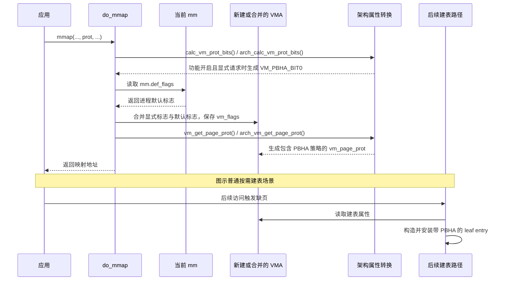

这里的“映射请求”指应用调用 `mmap()` 请求建立虚拟地址范围，不是硬件发出的访存事务。普通按需分配场景先建立 VMA，访问时才建立具体页表项；文件驱动或预填充等路径可以更早建表，但同样需要使用约定的映射属性。

`mmap` 的显式标志与进程默认标志合并，因此默认值为 `1` 时，省略 `PROT_PBHA_BIT0` 不能表达关闭。需要局部关闭时，按第 5.4 节的目标设计对该范围执行 `mprotect()`。

### 5.4 mprotect：修改范围与已有映射

`mmap()` 创建新 VMA；`mprotect()` 修改已有虚拟地址范围。地址范围已经有 VMA，但其中的页面可以尚未建立物理映射。两者都复用 VMA 保存 PBHA 策略，不要求为了设置属性提前分配物理页。

本设计采用本次讨论确认的接口语义：**`mprotect()` 的 PBHA 标志与 READ、WRITE 一样，由本次 `prot` 参数重新指定；传入 `PROT_PBHA_BIT0` 则设置，省略则清除。** 它只影响指定范围，不改变 `mm->def_flags`。这与 `mmap()` 合入进程默认标志的规则不同。

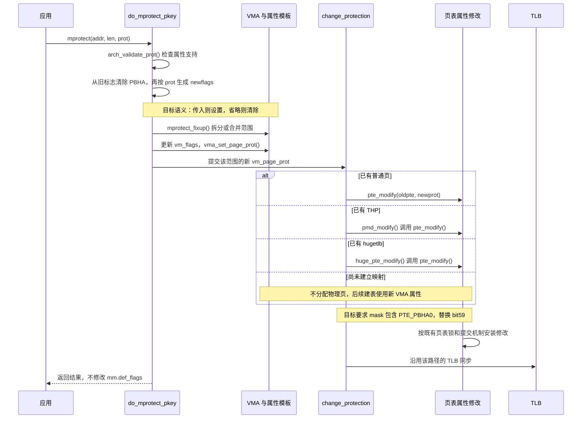

这里的图表示目标设计，不表示首页基线已经实现全部步骤。落实设计需要把 `VM_PBHA_BIT0` 纳入旧 VMA 标志清除集合，并使 `pte_modify()` 的更新掩码包含 `PTE_PBHA0`。后者会被普通页、THP 和 hugetlb 的属性修改路径复用，不需要额外调用进程级全地址空间 walker。

`pte_modify()` 只替换掩码指定的属性位，保留物理地址和其他应保留的状态；因此“已走到页表更新函数”并不保证 PBHA 被更新。基线遗漏 bit59 的掩码，是已有映射不同步的原因。

采用省略即清除的语义会改变基线保留 PBHA 的行为：应用后续仅修改读写权限时，如需保持 PBHA，应继续传入 `PROT_PBHA_BIT0`。该兼容性变化是此项接口设计的一部分。

### 5.5 并发与一致性契约

- 使用 `mmap_write_lock_killable()` 串行化 VMA 结构与策略修改；遍历时使用 PTE/PMD 锁保护具体页表项。
- 用 MMU notifier 通知依赖该地址空间的其他 MMU 使用者，用 `flush_tlb_mm()` 使旧转换属性失效。
- 未建立的页表项不需预先分配；通过 VMA 属性保证后续建立映射时应用策略。
- 设计要求成功返回后，受支持映射的后续访问使用新属性。更新期间正在执行的访存不构成“同一瞬间全部切换”的事务；使用条件限定为 performance-only。
- 并发控制请求的状态判断应与写锁保护一致。遍历错误必须有明确传播或恢复策略，不能把部分完成作为完整成功。

基线中的提前返回、锁外状态读取及遍历结果处理尚需收敛，详见第 10 节。

### 5.6 fork、exec 与共享关系

| 场景 | 策略说明 |
| --- | --- |
| 同一进程的线程 | 共享 mm，进程级请求对共享地址空间生效 |
| fork | VMA 复制及 mm 默认标志机制用于继承策略；`VM_INIT_DEF_MASK` 包含 `VM_PBHA_BIT0` |
| exec | `mm_init()` 从当前 mm 复制可继承默认位，新程序映射按默认策略建立；旧程序单个 VMA 的局部选择不作为独立配置保留 |
| 共享物理页 | 不同 mm 可采用不同映射属性，平台必须保证别名访问的数据一致性 |
| global init | `pbha=enable` 下，`maybe_mk_pbha_bit0()` 对其特定缺页路径添加 VMA bit0 标志；procfs 禁止直接修改该任务 |
| `VM_PFNMAP` | 进程级 walker 跳过其页表；基线 VMA 标志更新未同步排除，不能承诺统一切换语义 |
| hugetlb / PUD Block | 存在部分建表接入，但不能据此承诺进程级动态遍历完整覆盖 |

global init 的特殊处理不等于“强制所有用户进程永久设置 bit0”。它不直接设置 `mm->def_flags`，应分别检查实际 VMA 继承和默认策略。

#### 5.6.1 fork：复制策略，建立独立的地址空间

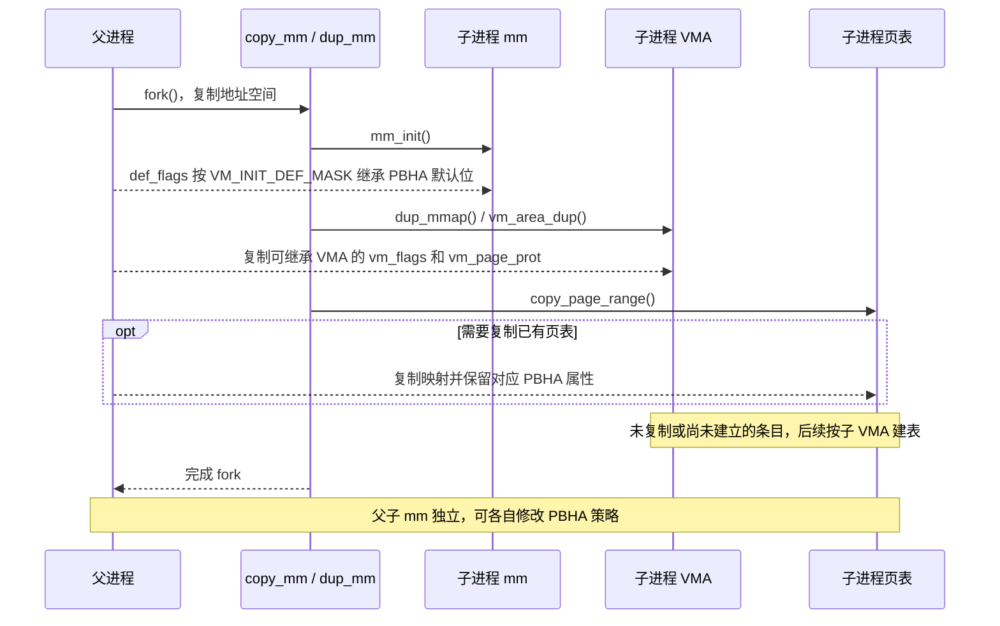

普通 fork 后父子拥有不同的 mm 和页表，但可以暂时共享物理页；PBHA 属于各自的映射。写时复制需要建立新 PTE 时，继续使用相应 VMA 的策略。图中只讨论可继承 VMA，`VM_DONTCOPY` 等原有继承规则仍然生效。

#### 5.6.2 exec：保留默认策略，重新建立程序映射

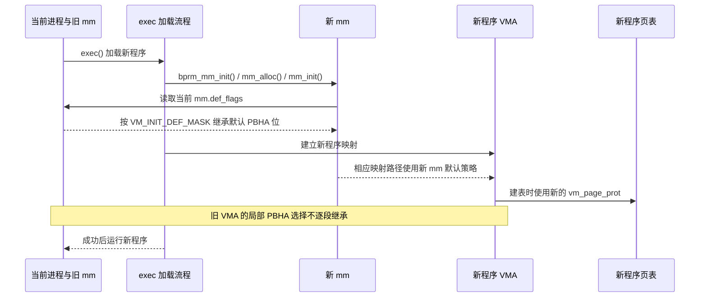

例如旧进程默认值为 `0`，只对一个 VMA 设置了 bit0，exec 后不会记住该地址段的局部选择；默认值若为 `1`，新 mm 则继承这个默认值。exec 创建临时栈等有独立路径，图示表达默认策略的继承关系，不据此保证基线所有早期已建页表都完成了属性同步。

#### 5.6.3 共享 mm 与共享物理页是两种情况

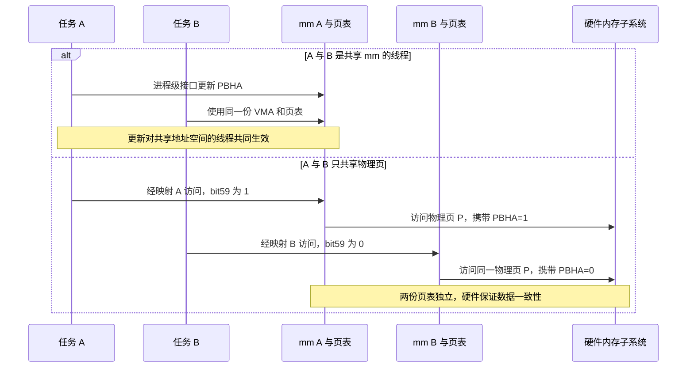

共享 mm 的线程共同使用策略；只共享物理页的两个进程仍可持有不同的 leaf entry。修改 B 的映射不会因为物理页相同而改写 A 的页表项；平台负责保证不同 PBHA 属性访问同一数据时的一致性。

#### 5.6.4 global init：缺页路径的特殊策略

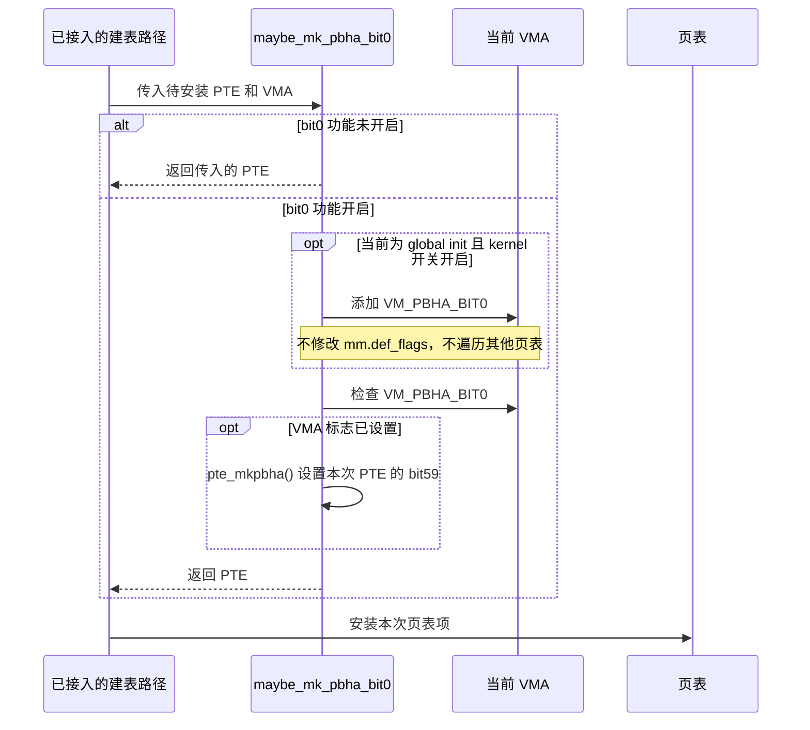

该辅助函数不直接设置 `mm->def_flags`，也不遍历 init 的全部已有页表。因此只能据具体 VMA 和页表判断策略，不能推出“init 及其所有后代的默认值都为 1”。procfs 禁止直接修改 global init 是入口权限规则，与这里的自动建表策略是两回事。

### 5.7 权限与错误处理

procfs 条目权限为 `0644`，通过文件权限及任务有效性检查约束访问；`prctl` 操作当前地址空间。函数级任务检查并未在两个入口完全统一，不能把 procfs 的全部限制视为公共接口保证。

| 情况 | 基线行为或设计要求 |
| --- | --- |
| prctl 参数不是 `0/1`，或多余参数非零 | 返回 `-EINVAL` |
| bit0 未启用 | procfs 条目被隐藏；公共更新函数返回 `-EINVAL` |
| 目标任务消失 | procfs 可返回 `-ESRCH`；无法取得 mm 时可返回 `-ENOENT` |
| procfs 目标不满足任务条件 | 返回 `-EACCES` |
| 用户数据复制失败 | 返回 `-EFAULT` |
| 获取 mmap 写锁被信号打断 | 返回 `-EINTR` |
| 未启用时传入 mmap 扩展位 | 架构转换不设置对应 VMA 位；不能承诺 mmap 一定显式报错 |
| mprotect 请求不被架构允许的属性 | `arch_validate_prot()` 可拒绝并返回 `-EINVAL` |

### 5.8 观测接口：默认值、VMA 与页表

观测接口分别报告默认策略、VMA 策略和页表属性，不能互相替代。

| 接口 | 观测对象 |
| --- | --- |
| 启动日志 | bit0 功能开关及内核策略开关 |
| `/proc/<pid>/pbha_bit0` | mm 默认策略；不是所有页的聚合结果 |
| `/proc/<pid>/smaps` 的 `p0` | 对应 VMA 的 `VM_PBHA_BIT0` |
| `/proc/<pid>/pagemap` 的 bit59 | 本分支扩展导出的页表 PBHA bit0 信息；需结合 present/swap 状态解释 |
| 内核 ptdump 的 `PBHA0` | 已建立内核映射的 bit59 |

pagemap 的 bit59 是用户可见记录格式中的扩展位；即使与硬件页表位号相同，也不能把整条 pagemap 记录视为原始 PTE。

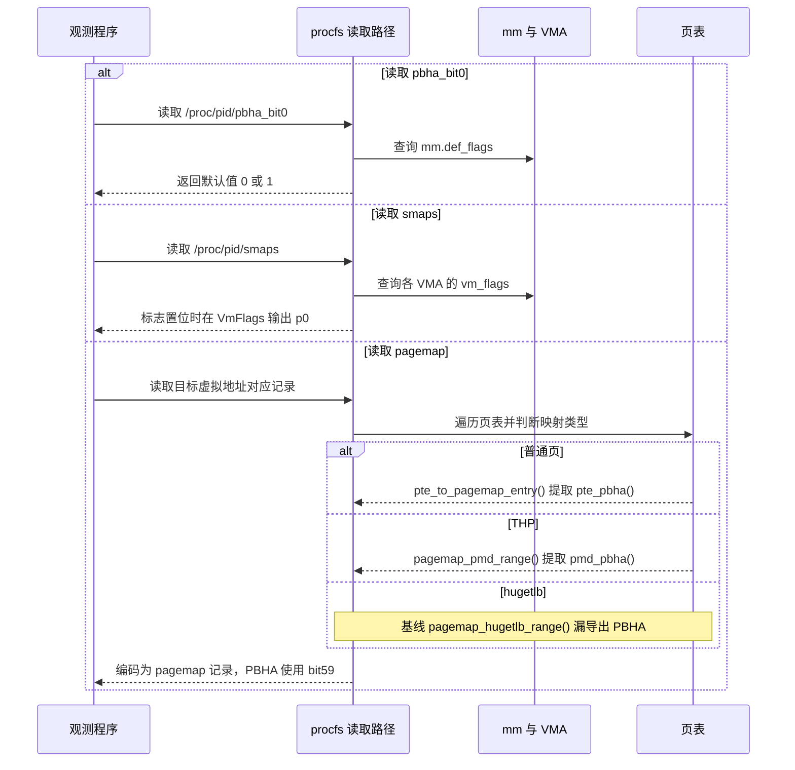

`p0` 表示 VMA 设置了 PBHA bit0 标志，不表示属性值为零。pagemap 是独立的用户接口格式，需从不同类型的页表项提取属性后再编码，不能直接复制原始 64 位描述符。基线普通页和 THP 已有提取路径，`pagemap_hugetlb_range()` 缺少相应导出，不能把其返回的零当作硬件属性为零的依据。

## 6. 数据面设计

### 6.1 属性进入硬件映射

数据面消费的输入是 CPU 转换控制和叶子项属性。内核通过下列映射维护路径准备这些输入：

| 映射场景 | 属性接入方式 |
| --- | --- |
| 普通匿名页首次建表 | `do_anonymous_page()` 使用 VMA 页保护属性，并调用 `maybe_mk_pbha_bit0()` |
| 写时复制 | `wp_page_copy()` 生成新 PTE 时继续应用 VMA 策略 |
| 文件页等普通 PTE 安装 | `alloc_set_pte()` 应用相同辅助函数 |
| 显式大页安装 | `set_huge_pte_at()` 调用辅助函数；动态切换覆盖另行确认 |
| 普通 PTE / THP 已有映射 | 由控制面的页表遍历设置或清除 bit59 |
| 内核映射 | `pgprot_pbha_bit0()` 接入 `__create_pgd_mapping()`、vmemmap、fixmap、vmap 等路径 |

`pgprot_pbha_bit0()` 只有在 bit0 和内核 bit0 两个开关都启用时才修改属性。`maybe_mk_pbha_bit0()` 在功能启用后检查 VMA 策略，并处理 global init 的特例。

对于 swap、迁移、THP 拆分/合并及映射权限变更，应保持最终属性与 VMA 策略一致。上述目标必须按各自路径验证，不能由几个缺页接入点推导为全部已覆盖。

### 6.2 缺页建表：将策略写入 leaf entry

控制面保存策略后，缺页路径负责把策略写入实际映射。以普通匿名页首次写入为例，页面分配和物理地址选择沿用原机制，PBHA 作为附加属性进入页表项。

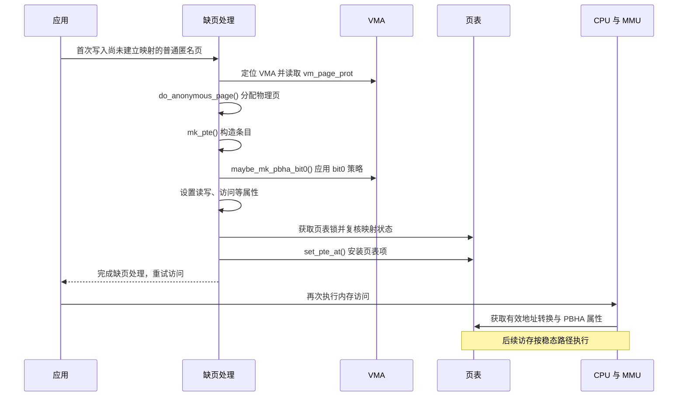

图中限定为普通匿名页的首次写入；只读零页、文件页、COW 和大页走各自的建表分支。它们共享的设计原则是从 VMA 或相应映射策略生成最终描述符属性，不能因为路径不同而丢失 PBHA。

- **新建映射**：读取 `vm_page_prot` 并经过对应属性辅助函数，生成包含 bit59 的页表项。此时没有需要替换的旧有效映射，不应照搬进程级更新的全 mm 刷新。
- **已有映射**：由进程级更新或地址范围级更新修改 leaf entry，并沿用各自的 TLB 同步流程。仅修改 VMA 不能改变 TLB 中已有的属性。
- **映射建立后**：普通访存不逐次调用 PBHA 软件代码。内核负责属性正确生成与同步，缓存策略的实际执行由硬件承担。

HBM Cache 与 CPU 的 SRAM Cache 可以处于不同层次。PBHA bit0 的平台含义是 HBM Cache bypass，不意味着每次访存都绕过 L1/L2/L3 或直接访问 DDR。是否向后级发出事务、哪一模块消费属性，由具体芯片决定。本文没有获得目标平台 HHA 与 HBM 控制器的实现规格，因此不指定 PBHA 必须在哪个硬件模块消费，也不将其他型号的结构直接套用于目标平台。

### 6.3 稳态访存：硬件消费属性

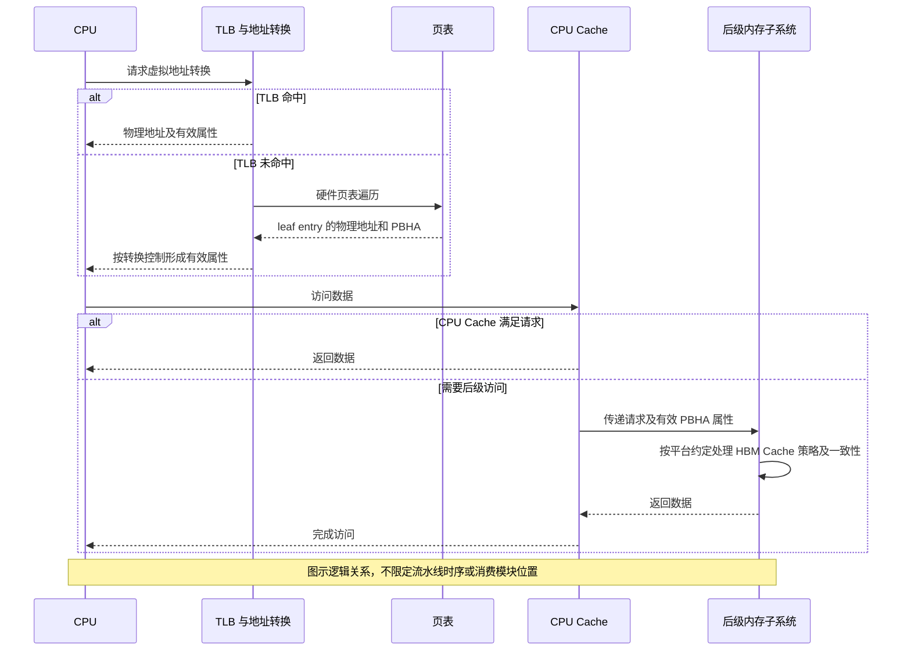

在映射有效、无需缺页处理的情况下，访问不进入 `pbha.c`。TLB 缓存转换属性，所以修改内存中的 PTE 后必须完成相应失效流程，不能依靠“下次访问重新查表”保证立即生效。

本设计不承诺每条指令都产生可在外部总线上观测到的事务；具体缓存层级是否消费 PBHA、何时向后级传递，属于芯片实现。

### 6.4 正确性与性能约束

1. PBHA 为同一物理内存的访问附加策略，不改变地址解析结果，也不隐式搬迁数据。
2. 保留既有读写、执行、内存类型及共享属性约束；硬件不得借 PBHA 绕过访问权限。
3. 页表和 TLB 属性变化必须与平台要求一致。基线没有专门为 bit0 切换增加数据缓存清理过程，应确认 performance-only 约定足以满足正确性。
4. 未启用路径采用 static key 和编译期空实现减少附加判断。实际关闭态开销仍需基准验证。
5. 进程级更新开销与 VMA 数、已遍历页表规模相关，并包含地址空间 TLB 刷新；不适合逐次内存访问或高频细粒度调度。
6. 性能收益依赖工作集、并发负载和平台策略，不能仅由 bit59 设置成功推导出收益。

## 7. 虚拟化边界

Stage 1 与 Stage 2 的 PBHA 合成方式由实现决定。宿主 bit0 功能可用，不自动意味着 Guest 可以使用相同属性。

设计采用受限开放方式：

1. 通过 CPU 型号和 EL2 条件确认已知的合成行为。
2. 从 performance-only 值集合推导 Guest 可使用的安全位集合。
3. 只有所有可由这些位构造出的非零值都在白名单内，才允许开放对应组合。例如开放值 `5` 涉及 bit0、bit2，还需确认值 `1`、`4` 安全。
4. 在已知 Stage 2 覆盖 Stage 1 的平台上，KVM 使用 Stage 2 默认零属性限制不允许的位，并按安全位集合调整控制。

相关落点为 `decompose_pbha_values()`、`stage2_test_pbha_value()`、`plat_can_use_pbha_stage2()` 和 `kvm_arm_setup_stage2()`。基线已知型号表包含 Neoverse N1、Cortex-A76/A77/A78；该表不能替代目标 SoC 验证。

早期 EFI 路径对安全位集合的衔接存在待确认项，见第 10 节。在完成确认前，本文不承诺 Guest 透传已可用。

## 8. 设计取舍与兼容性

| 取舍 | 原因与影响 |
| --- | --- |
| 属性绑定映射 | 可按进程和 VMA 选择策略；平台必须支持不同别名属性下的数据正确性 |
| 通用能力与平台 bit0 策略分层 | 通用 PBHA 保留四位和值白名单模型，平台接口只暴露已约定的 bit0 |
| 全局模式只在启动设置 | 避免运行时重建所有 CPU 转换控制和内核映射；用户策略仍可动态调整 |
| 复用 VMA 和 pgprot | 后续建表路径能够消费持久策略；须检查所有会重建或修改映射的路径 |
| 进程级更新复用 pagewalk | 覆盖普通页及 THP 的共享实现；特殊映射需要专门定义支持边界 |
| 白名单限定为 performance-only | 支持共享页和默认属性别名；不覆盖加密、数据格式转换或要求移除所有别名的属性 |

本设计基于 OLK-5.10 的 UAPI、页表位分配和调用路径。移植到其他内核前必须重新检查 `PROT_*`、`VM_HIGH_ARCH_*`、pagemap 位分配、页表描述符格式以及特性初始化时序，不能仅复制函数。

## 9. 验证与验收设计

本节定义验证计划，不表示相关测试已执行。基础软件验证与目标硬件效果验证应分别记录结果。

| 类别 | 关键场景 | 验收关注点 |
| --- | --- | --- |
| 构建 | 配置开/关、THP 开/关 | 依赖和空实现完整，无新增构建错误 |
| 使能条件 | HPDS2 有/无、Cache/Memory 模式、EFI 读取失败 | 仅在满足条件时开放 bit0；缺失条件正常回退 |
| 参数健壮性 | 缺省、user、enable、空值、非法值 | 合法模式准确；异常输入不崩溃、不误启用策略 |
| 固件解析 | chosen/cpus 两条路径、空列表、越界值 | 优先级正确，边界检查充分，开放位与允许值一致 |
| 多 CPU | 启动 CPU、次级 CPU、热插拔 | 寄存器与系统能力保持一致，拒绝不兼容能力 |
| 新映射 | 匿名/文件映射，显式 bit0，mm 默认 bit0 | VMA、vm_page_prot 和 fault 后的页表属性一致 |
| 进程级切换 | procfs/prctl、设置/清除、已有页及未 fault 页 | 默认策略与受支持映射同步，成功返回后的属性可观测 |
| 接口混用 | 单 VMA 与 mm 默认不同，再次写同值 | 不出现“返回成功但未达成统一策略”的未定义行为 |
| 并发 | 多线程切换、并行 fault、退出、信号中断 | 锁和引用有效，无死锁、越界或静默部分成功 |
| 生命周期 | fork、exec、COW、swap、迁移 | 保持约定的默认与局部策略，不丢失属性或破坏数据 |
| 大页和特殊映射 | THP、hugetlb、PUD Block、VM_PFNMAP | 按实际覆盖分项验收，未支持场景明确拒绝或限制 |
| mprotect | 对 present 页设置/清除 bit0 | VMA 与页表同步；基线问题修复前不得判为通过 |
| 内核映射 | 线性映射、vmalloc、vmemmap、fixmap | enable 模式的已接入路径属性正确，user 模式不自动添加 |
| KVM | 白名单组合、早期初始化、已知/未知 CPU | 不开放未确认属性；Guest 使用能力单独验证 |
| 数据正确性 | 不同属性别名、共享页、并发读写 | 数据一致，无权限或内存类型语义变化 |
| 性能 | 功能关闭、启动开启、动态切换、目标负载 | 记录关闭态开销、切换时延及 PMU/带宽/延迟变化 |

硬件验收前应具备 SoC 的 bit0 语义说明和可观测指标。软件 pagemap/ptdump 只能证明属性设置，硬件计数器或平台测量才能证明缓存策略实际生效。

## 10. 基线实现差距与待确认事项

以下结论来自静态代码阅读，不等同于已复现缺陷。其用途是限定设计承诺和安排后续验证，本次文档编写未修改内核代码。

| 编号 | 观察 | 对设计或验收的影响 |
| --- | --- | --- |
| D1 | `early_pbha_init()` 读取 `/cpus` 属性后使用 `if (prop) return`，与回退意图相反；`/chosen` 不存在时也直接返回 | `/cpus` 回退不能按正常实现承诺，需修正判定并补齐空属性检查 |
| D2 | `efi_parse_options()` 接受参数名，`setup_pbha()` 对参数直接调用 `strcmp()` | 裸参数及非法值需补齐健壮性；不能把“EFI 已识别”当作模式合法 |
| D3 | `mprotect` 旧标志清除集合不含 `VM_PBHA_BIT0`，`pte_modify()` 的更新 mask 不含 `PTE_PBHA0` | VMA 局部清除和已有 PTE 属性更新不完整；前文接口定义明确限制，需专门修复后验收 |
| D4 | `pbha_bit0_update_vma()` 仅按 mm 默认值相同就提前返回，且该判断发生在 mmap 写锁之外 | 无法保证同值调用统一已有局部差异；并发请求需锁内复核并明确幂等契约 |
| D5 | 进程级更新忽略 `walk_page_range()` 返回值；walker 跳过 PFNMAP，但 VMA 标志遍历未跳过 | 错误传播和特殊映射状态一致性不完整，不能承诺所有映射已同步 |
| D6 | 运行时 walker 提供 PMD/PTE 路径，没有 hugetlb 专用回调 | 显式大页建表接入不代表运行时切换完整支持，应逐类验证 |
| D7 | 早期初始化设置 `pbha_enabled` 后，后续 Stage 1 检测可跳过包含 `stage2_test_pbha_value()` 的路径 | 早期启动路径下 Stage 2 安全位可能保持零，Guest 属性开放需单独确认 |
| D8 | procfs 和 prctl 的目标检查不完全一致；global init 特例仅修改特定 VMA | 不应承诺统一的 init 限制或“所有后代默认开启”，需要完善接口和继承测试 |
| D9 | issue #9826 可能是基于代码的 AI 辅助整理，不能独立证明原始接口设计意图 | 本文采用的平台 bypass 语义、TLB 外维护要求及硬件效果仍须芯片规格确认 |
| D10 | `pagemap_hugetlb_range()` 未提取并导出 PBHA bit0 | hugetlb 映射的 pagemap 属性报告不完整；与进程级 walker 未覆盖 hugetlb 是两个不同问题 |

## 11. 设计追踪与参考

### 11.1 源码落点

相对路径基于本文所在目录；阅读时应核对首页记录的提交，避免工作树更新造成版本偏差。

| 模块 | 源文件 |
| --- | --- |
| EFI 命令行与入口 | [efi-stub.c](../pbha/olk-5.10/drivers/firmware/efi/libstub/efi-stub.c)、[efi-stub-helper.c](../pbha/olk-5.10/drivers/firmware/efi/libstub/efi-stub-helper.c) |
| 固件描述生成 | [fdt.c](../pbha/olk-5.10/drivers/firmware/efi/libstub/fdt.c) |
| 内核早期入口与参数 | [head.S](../pbha/olk-5.10/arch/arm64/kernel/head.S)、[setup.c](../pbha/olk-5.10/arch/arm64/kernel/setup.c) |
| CPU 与 PBHA 能力 | [cpufeature.c](../pbha/olk-5.10/arch/arm64/kernel/cpufeature.c) |
| 平台 bit0 核心 | [pbha.c](../pbha/olk-5.10/drivers/soc/hisilicon/pbha.c)、[pbha.h](../pbha/olk-5.10/include/linux/pbha.h) |
| 用户映射属性转换 | [mman.h](../pbha/olk-5.10/arch/arm64/include/asm/mman.h) |
| 页表位与属性操作 | [pgtable-hwdef.h](../pbha/olk-5.10/arch/arm64/include/asm/pgtable-hwdef.h)、[pgtable.h](../pbha/olk-5.10/arch/arm64/include/asm/pgtable.h) |
| 进程级接口 | [base.c](../pbha/olk-5.10/fs/proc/base.c)、[sys.c](../pbha/olk-5.10/kernel/sys.c) |
| 用户建表与权限变更 | [memory.c](../pbha/olk-5.10/mm/memory.c)、[mmap.c](../pbha/olk-5.10/mm/mmap.c)、[mprotect.c](../pbha/olk-5.10/mm/mprotect.c) |
| 内核和大页映射 | [mmu.c](../pbha/olk-5.10/arch/arm64/mm/mmu.c)、[vmalloc.c](../pbha/olk-5.10/mm/vmalloc.c)、[hugetlbpage.c](../pbha/olk-5.10/arch/arm64/mm/hugetlbpage.c) |
| 继承与 ABI | [fork.c](../pbha/olk-5.10/kernel/fork.c)、[mm.h](../pbha/olk-5.10/include/linux/mm.h)、[UAPI mman.h](../pbha/olk-5.10/arch/arm64/include/uapi/asm/mman.h)、[prctl.h](../pbha/olk-5.10/include/uapi/linux/prctl.h) |
| 观测 | [task_mmu.c](../pbha/olk-5.10/fs/proc/task_mmu.c)、[ptdump.c](../pbha/olk-5.10/arch/arm64/mm/ptdump.c) |
| KVM 控制 | [reset.c](../pbha/olk-5.10/arch/arm64/kvm/reset.c) |
| 原有特性文档 | [pbha.rst](../pbha/olk-5.10/Documentation/arm64/pbha.rst)、[kernel-parameters.txt](../pbha/olk-5.10/Documentation/admin-guide/kernel-parameters.txt) |

### 11.2 设计来源

- [目标平台需求 issue #9826：moc 混合内存管理特性](https://atomgit.com/openeuler/kernel/issues/9826)：记录 Cache Bypass 与 PBHA0 的相关描述，2026-10-22 读取核对。据后续讨论，该内容为 AI 辅助整理，不能作为原始需求或 mprotect 限制语义的独立依据。

- [James Morse 2021 PBHA RFC 本地说明](../pbha/20211015_james_morse_arm64_mm_prototype_to_allow_drivers_to_request_pbha_values.cover)：通用 PBHA、performance-only 与 KVM 限制模型。
- [openEuler PBHA v2 补丁系列](https://mailweb.openeuler.org/archives/list/kernel@openeuler.org/thread/TIJIJA5JUR6D7CMNE7Q46MCNS4VJPCZ4/)：平台 bit0 与进程控制设计来源，接口数值以本文代码基线为准。
- [openEuler PR !2481](https://gitee.com/openeuler/kernel/pulls/2481)：本地历史确认于 2023-10-26 合入 OLK-5.10，合并提交 `7dfcf66ad7f6`。
- 本基线后续维护包含 static key 优化、pagemap 观测、固件属性传递和 `MemoryOnChipMode` 读取修复；本说明书不据此宣称这些扩展已进入 Linux 主线。
