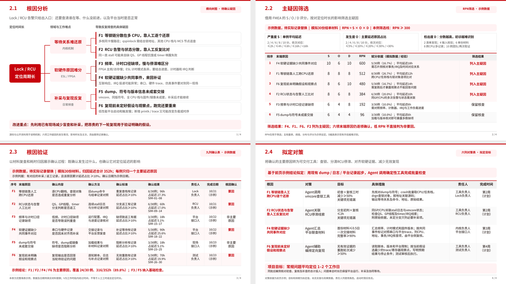
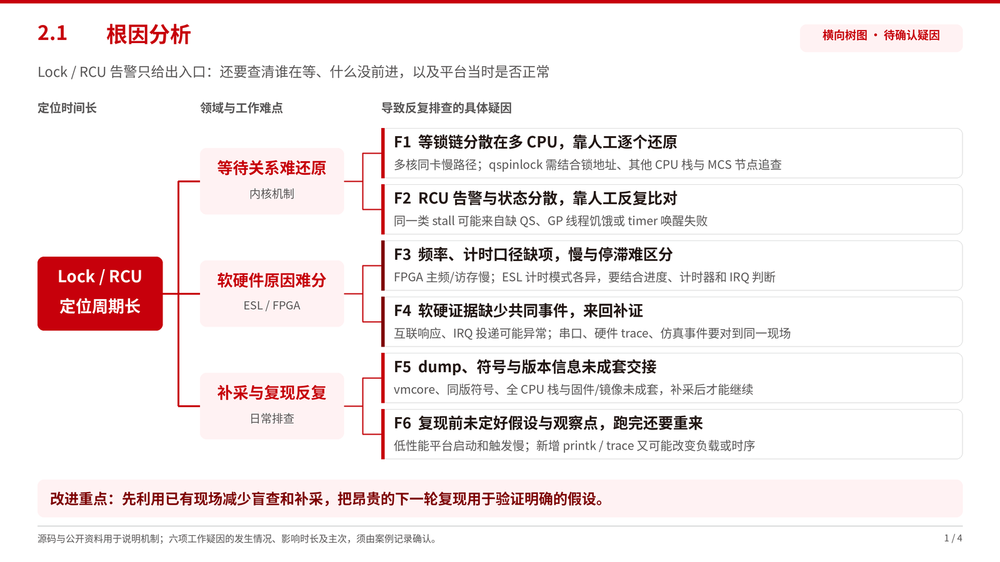
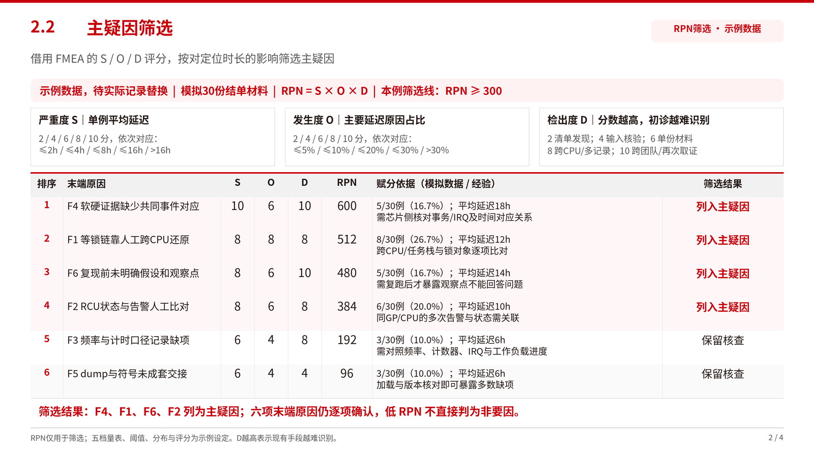
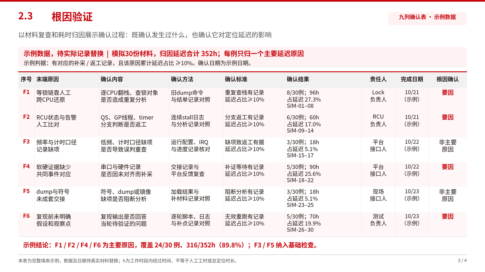
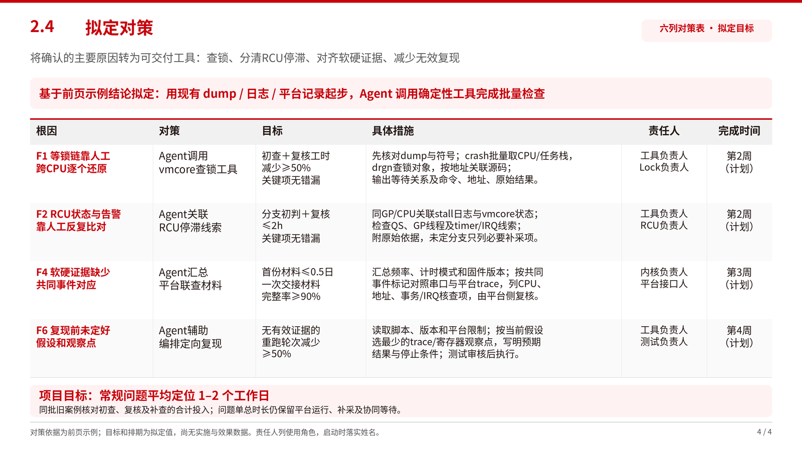

# 用 AI Agent 缩短 Lock/RCU 问题平均定位时长

四页 QCC 评审稿：横向树图、S/O/D 与 RPN 筛选、九列根因确认表、六列拟定对策表。内容覆盖内核查锁、RCU stall、ESL/FPGA 低频与计时、互联/中断及软硬协同。

**数据状态：30份材料、评分、耗时、确认结果及确认日期均为模拟填表示例，未开展对应的真实采样与验证。对策指标为拟定目标，尚无实测提效结果。**

- [下载可编辑 PPT](Lock_RCU_QCC_AI_Agent_4slides.pptx)
- [查看四页 PDF](Lock_RCU_QCC_AI_Agent_preview.pdf)
- [RPN 评分表](RPN评分.example.csv) · [九列根因确认表](根因确认.example.csv) · [六列对策表](对策表.example.csv)
- [30例数据明细](采样明细.example.csv) · [评分口径与数据源](review-data.example.json)
- [实际取证记录空表](要因确认记录表.csv) · [工具输入与研究依据](输入与依据.md) · [Agent 输入模板](agent-inputs.example.json)



## 2.1 根因分析

横向树图把领域难点落到六项具体原因：人工还原等锁链、人工比对 RCU 状态、频率与计时口径缺项、软硬证据缺少共同事件、现场材料未成套交接、复现前未定好假设与观察点。



## 2.2 主疑因筛选

使用 **RPN = S × O × D**。本课题示例用 2/4/6/8/10 五档评分：S 按单例平均延迟，O 按模拟样本中的发生比例，D 按初诊识别难度。D 越高越难识别。筛选线 300 分是本例约定，不是通用标准。

| 末端原因 | S | O | D | RPN | 筛选 |
|---|---:|---:|---:|---:|---|
| F4 软硬证据缺少共同事件对应 | 10 | 6 | 10 | 600 | 主疑因 |
| F1 等锁链靠人工跨 CPU 还原 | 8 | 8 | 8 | 512 | 主疑因 |
| F6 复现前未明确假设和观察点 | 8 | 6 | 10 | 480 | 主疑因 |
| F2 RCU 状态与告警人工比对 | 8 | 6 | 8 | 384 | 主疑因 |
| F3 频率与计时口径记录缺项 | 6 | 4 | 8 | 192 | 保留核查 |
| F5 dump 与符号未成套交接 | 6 | 4 | 4 | 96 | 保留核查 |



## 2.3 根因验证

九列按要求排列：**序号、末端原因、确认内容、确认方法、确认标准、确认结果、责任人、完成日期、根因确认**。通过材料复查展示补采、返工与延迟的对应关系。

示例设定为 30 例，Lock/RCU 各 15 例，硅片/FPGA/ESL 分别为 7/15/8 例；每例只归入一个主要定位延迟原因，避免重复累计。

| 原因 | 例数 | 可归因延迟 | 占比 | 示例确认 |
|---|---:|---:|---:|---|
| F1 | 8 | 96 h | 27.3% | 要因 |
| F2 | 6 | 60 h | 17.0% | 要因 |
| F3 | 3 | 18 h | 5.1% | 非主要原因 |
| F4 | 5 | 90 h | 25.6% | 要因 |
| F5 | 3 | 18 h | 5.1% | 非主要原因 |
| F6 | 5 | 70 h | 19.9% | 要因 |
| 合计 | 30 | 352 h | 100.0% | — |

示例判据为“有对应材料支持追加工作，且累计可归因延迟占比 ≥10%”。四项主要原因覆盖 24/30 例、316/352 h（89.8%）。这是模拟的延迟构成，不是已实现或可保证实现的提效比例。h 指工作时段内经过时间，包含复现和协同等待；既不是纯人工工时，也不是整单定位时间。



## 2.4 拟定对策

六列按要求排列：**根因、对策、目标、具体措施、责任人、完成时间**。四项对策为 Agent 调用 vmcore 查锁工具、关联 RCU 停滞线索、汇总平台联查材料、辅助编排定向复现。F3/F5 分别纳入平台核对和材料检查入口。

责任人使用岗位角色，完成时间按启动后第 2–4 周安排。目标中的 50%、2h、0.5日、90% 均为拟定值，尚未测量。常规问题平均定位 1–2 个工作日仍是项目总目标。



## 配色依据

参考华为官网发布的[《华为 ICT 学院视觉识别规范手册》2.1–2.2](https://e.huawei.com/marketingcloud/pep/asset/20000001/Material/37b18964a35f408c8118a4eccc54e8a1/M3T1A669N1068569492865695897/%E5%8D%8E%E4%B8%BAICT%E5%AD%A6%E9%99%A2-%E8%A7%86%E8%A7%89%E8%AF%86%E5%88%AB%E8%A7%84%E8%8C%83%E6%89%8B%E5%86%8C20241105.pdf)，采用华为红 **#C7000B**、黑色 **#231815**、深灰 **#595757** 和白底。红色用于标题、连接线与重点，表格使用浅灰表头和淡红重点行。沿用本机 Noto Sans CJK 字体；此文件为自制 QCC 材料。

## 修改与重新生成

[review-data.example.json](review-data.example.json) 保存示例数据、量表、职责和对策；[build_deck.py](build_deck.py) 负责计算 RPN、计数与占比，并生成四页材料。PPT 中的文字、框线和树图可编辑；PDF/PNG 为同一布局脚本生成的预览，并非 PowerPoint 应用截图。评分口径、技术边界和来源另见 PPT 备注及[研究依据](输入与依据.md)。

```sh
cd results/qcc-lock-rcu
python -m venv /tmp/qcc-deck-venv
/tmp/qcc-deck-venv/bin/pip install -r requirements.txt
/tmp/qcc-deck-venv/bin/python build_deck.py
```

验证环境为 Python 3.13，使用 Noto Sans CJK。默认读取 Linux 的 `/usr/share/fonts/opentype/noto/` 字体文件；其他系统可用 `QCC_FONT_REGULAR`、`QCC_FONT_BOLD`、`QCC_FONT_INDEX`、`QCC_FONT_NAME` 指定字体，普通 TTF/OTF 的索引通常为 `0`。

脚本会覆盖 PPT、PDF、图片、生成内容 JSON 和四个 `.example.csv`；手工修改的文件请先另存。已有实际取证记录表 `要因确认记录表.csv` 和 Agent 输入模板会保留。脚本校验 RPN 乘积、评分分档、30例与352h合计、四页结构和文字边界；这些检查不代表资料真实性已被验证。
